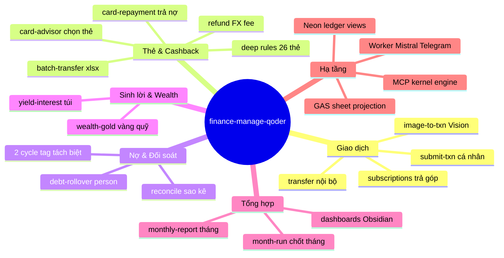
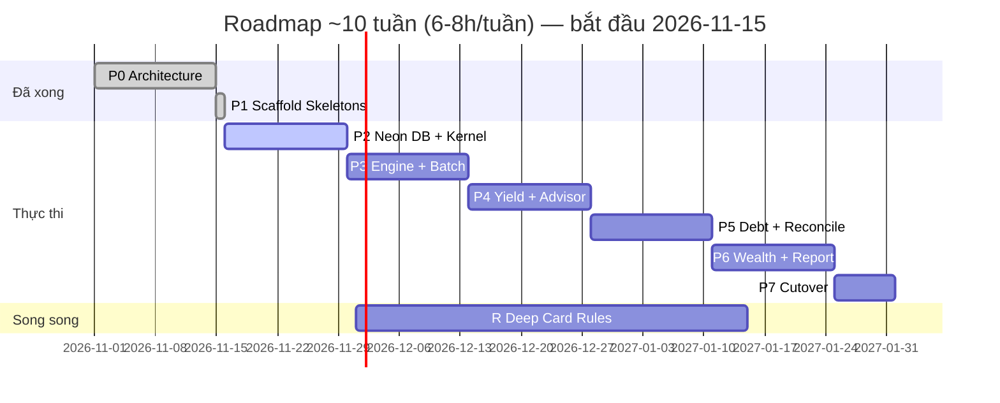
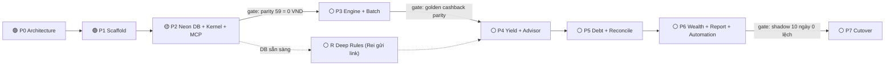

# 🗺️ MASTER PLAN — `finance-manage-qoder` (Agent-First / Zero App-Code)

> [!IMPORTANT] Mục tiêu
> Repo **độc lập, cùng cấp** `money-gemini` (không lồng). Chuyển hệ thống tài chính cá nhân sang **Agent-First**: AI Agent + Markdown skills + MCP kernel + engine deterministic + **Neon Postgres** (append-only ledger) + **Obsidian** (local-first) + Google Sheets (projection).
> **Phạm vi RỘNG hơn thẻ/cashback/nợ:** txn cá nhân, chuyển khoản, trả nợ thẻ, batch transfer (attach xlsx → `/batch` tự fill), túi sinh lời, đối soát, refund/FX, vàng/wealth, **report tháng chi tiết**.

## 0. TL;DR

| Mục | Giá trị |
| :--- | :--- |
| **Repo thực thi** | `/Users/rei/Github/finance-manage-qoder` (sibling, KHÔNG lồng money-gemini) |
| **Git remote** | `finance-manage-ag` — ⏳ chờ Rei gửi link push 1st commit |
| **Nguồn sự thật** | `money-gemini` (DB schema + `cashback.pure.ts` + 22 knowledge docs) — read-only reference |
| **Draft tham khảo** | `finance-manage-ag` — read-only, KHÔNG touch (reuse có kiểm chứng) |
| **Kiến trúc đã duyệt** | [`docs/architecture/agent-first-blueprint.md`](docs/architecture/agent-first-blueprint.md) |
| **Hiện tại** | 🟢 P0 Architecture + P1 Scaffold **DONE** · 🟡 P2 Neon DB + Kernel + MCP **NEXT** |
| **Bất biến** | [`skills/invariants.md`](skills/invariants.md) — hàng rào chống drift |

---

## 1. 🧠 SCOPE MINDMAP (toàn bộ flow tài chính cá nhân)

---

## 2. 🔥 HEATMAP TIẾN ĐỘ

| Phase | Hạng mục chính | Heatmap | % | Trạng thái |
| :--- | :--- | :---: | :---: | :--- |
| **P0** Discovery & Architecture | Audit DB + 22 docs, chốt blueprint Neon+MCP+Obsidian | `██████████` | 100% | 🟢 **DONE** |
| **P1** Repo Scaffold & Skeletons | Repo sibling + 76 MD skeleton (26 thẻ, 16 people, 13 skills...) + PLAN | `██████████` | 100% | 🟢 **DONE** |
| **P2** Neon DB + Kernel + MCP | Freeze/backup, schema, views, RPC, migrate parity, MCP write, submit-txn | `░░░░░░░░░░` | 0% | 🟡 **NEXT** |
| **P3** Cashback Engine + Batch | Port `cashback.pure.ts`, `batch_xlsx.py`, card-repayment, `/batch` | `░░░░░░░░░░` | 0% | ⚪ TODO |
| **P4** Yield + Advisor + Dashboards | yield-interest, card-advisor, MCC snapshot, dashboard cards | `░░░░░░░░░░` | 0% | ⚪ TODO |
| **P5** Debt + Reconcile + Refund | debt-rollover (correlation id), reconcile, refund/FX, dashboard debt | `░░░░░░░░░░` | 0% | ⚪ TODO |
| **P6** Wealth + Report + Automation | wealth-gold, monthly-report, month-run, Worker/Mistral/Telegram, cron | `░░░░░░░░░░` | 0% | ⚪ TODO |
| **P7** Cutover & Decommission | Parity gate, archive `money-gemini/src`, Supabase read-only | `░░░░░░░░░░` | 0% | ⚪ TODO |
| **R** Deep Card Rules (song song) | Rei gửi link 26 thẻ → điền `cashback_rules` + regenerate MD | `░░░░░░░░░░` | 0% | ⚪ TODO (chờ link) |

**Tổng:** `█░░░░░░░░░` **~15%** (P0+P1 xong; phần implementation lớn ở phía trước).
> ⚠️ Không copy tiến độ "82%" của draft `finance-manage-ag` — repo mới **chỉ có scaffold**, chưa DB/kernel/scripts.

---

## 3. 📅 MILESTONE TIMELINE

---

## 4. 📋 CHI TIẾT PHASE / SPRINT

> Mỗi sprint = 1 branch = 1 PR. Gate không đạt = **DỪNG**, không drift. Chi tiết migration gốc: blueprint §6 (M0–M7).

### 🟢 P0 — Discovery & Architecture (DONE)
| Sprint | Việc | Kết quả |
| :--- | :--- | :--- |
| P0-S1 | Audit `money-gemini`: 22 knowledge docs, `cashback.pure.ts`, `financial.service.ts`, schema, GAS v25 | Inventory ✅ |
| P0-S2 | Blueprint agent-first (Neon ledger + views + port engine + MCP + Obsidian) | [`agent-first-blueprint.md`](docs/architecture/agent-first-blueprint.md) ✅ |

### 🟢 P1 — Repo Scaffold & MD Skeletons (DONE — phiên này)
| Sprint | Việc | Kết quả |
| :--- | :--- | :--- |
| P1-S1 | Tạo repo sibling + cây thư mục + `.gitignore` + `.env.example` | ✅ |
| P1-S2 | Sinh 76 MD skeleton: 26 thẻ + 25 bank + 16 people + 3 pocket + 4 wealth + 13 skill + config + dashboard | ✅ structural pre-fill, rules TODO |
| P1-S3 | PLAN + README + AGENTS + copy blueprint + invariants | ✅ |

### 🟡 P2 — Neon DB + Kernel + MCP (NEXT — bắt đầu tại đây)
| Sprint | Việc | Gate |
| :--- | :--- | :--- |
| P2-S1 | Freeze + `pg_dump` source; tag `pre-v2`; golden snapshot 5 sheet; **port 22 knowledge docs** → `docs/knowledge/` | restore thử được; snapshot khớp |
| P2-S2 | Neon schema DDL: 5 core tables + append-only ledger (`transactions`, `transaction_events`) + `cashback_rules`/`type_configs` | schema khớp engine |
| P2-S3 | SQL views (`v_account_available_balance`, `v_person_cycle_debt`, `v_card_cycle_cashback`, `v_batch_pending_clear`) + RPC `submit_agent_txn`, `compute_card_cycle_tag` | view trả số đúng |
| P2-S4 | Migrate data **giữ 100% UUID**; đối soát chéo | **parity 59/59 = 0 VND**; đếm 996 txn + 1.224 events |
| P2-S5 | MCP kernel write path (catalog/ledger/preview/submit) + idempotency + outbox→GAS; skills `submit-txn`, `transfer`, `samsung-image-to-txn` | submit trùng = 1 row |

### ⚪ P3 — Cashback Engine + Universal Batch
| Sprint | Việc | Gate |
| :--- | :--- | :--- |
| P3-S1 | **Port `cashback.pure.ts`** (standard + tiered) → `kernel/engine`; golden parity từng kỳ | 0 lệch semantics |
| P3-S2 | `scripts/batch_xlsx.py` inspect/generate (clone 100% xlsx); Rei **attach `mbb.xlsx`/`vib.xlsx`** → inspect → `_TEMPLATE_SCHEMAS.md` | generate giữ style/dropdown |
| P3-S3 | Skills `card-repayment` + `batch-transfer` (`/batch` tự fill dư nợ → list txn chờ duyệt) | 2 mode đúng; headroom root |

### ⚪ P4 — Yield + Advisor + Dashboards
| Sprint | Việc | Gate |
| :--- | :--- | :--- |
| P4-S1 | `yield-interest` (threshold + daily, note chuẩn) | lãi đúng N ngày |
| P4-S2 | `card-advisor` + MCC snapshot (catalog); simulate cap/min_spend | Manwah→5812→top1 đúng |
| P4-S3 | Dashboard Obsidian `01-cards-cashback-cap` (read-only view) | iPad đúng số |

### ⚪ P5 — Debt + Reconcile + Refund
| Sprint | Việc | Gate |
| :--- | :--- | :--- |
| P5-S1 | `debt-rollover` — **correlation id thay heuristic**; cascade cancel | 2 khoản cùng tiền không nhầm cặp |
| P5-S2 | `reconcile-statement` (pull-first, không wipe cột K) | lệch được flag, không tự sửa |
| P5-S3 | `refund` + FX deferred (`fx_fee_on_refund` JCB); dashboard `02-people-debt-matrix` | FX không lẫn balance |

### ⚪ P6 — Wealth + Report + Automation + Channels
| Sprint | Việc | Gate |
| :--- | :--- | :--- |
| P6-S1 | `wealth-gold` (quantity/price, vị thế) | giá vốn đúng |
| P6-S2 | `monthly-report` (thu/chi, cashback real_awarded, debt, yield, wealth) | số từ views, không tính tay |
| P6-S3 | `month-run` orchestrator (close→batch→interest→rollover→report→sync) | chạy lại không duplicate |
| P6-S4 | Online bridge: Cloudflare Worker + Mistral/Pixtral + Telegram + GAS v25 | bot 24/7 |
| P6-S5 | GitHub Actions cron + **shadow run 10 ngày**; dashboards `00`/`03` | 01/01 tab mới tự sinh 5 sheet; 0 lệch |

### ⚪ P7 — Cutover & Decommission
| Sprint | Việc | Gate |
| :--- | :--- | :--- |
| P7-S1 | Parity tổng + nghiệm thu acceptance (blueprint §8) | tất cả checkbox đạt |
| P7-S2 | Tắt Hermes/Quick Add; archive `money-gemini/src` → `.archive` `@archived` | app không gọi 2 tuần |
| P7-S3 | Supabase read-only 2 tuần; restore drill máy sạch | restore ok |

### ⚪ R — Deep Card Rules (song song, chờ Rei gửi link)
| Sprint | Việc | Gate |
| :--- | :--- | :--- |
| R-S1 | Rei gửi link/ảnh điều khoản từng thẻ (26) → điền tier/MCC/sub-cap/min_spend | không hardcode rate |
| R-S2 | Ghi `cashback_rules` + `cashback_type_configs` (Neon) → **regenerate** `accounts/cards/*.md` §2/§3 | MD schema khớp engine |

---

## 5. 👉 BƯỚC TIẾP THEO (P2 — làm gì ngay, đúng thứ tự)

> Rei hỏi: "DB migration, tạo agent, connect MCP... chỉ tui tiếp theo". Đây là lộ trình **không drift**:

| # | Việc | Lệnh / Hành động cụ thể | Ai |
| :-- | :--- | :--- | :--- |
| **1** | **Chốt hạ tầng DB** | Trả lời câu hỏi §7 (Neon free vs Supabase Pro; reuse draft assets?) | Rei |
| **2** | **Freeze + backup source** | `pg_dump` money-gemini Supabase (scoped export, KHÔNG service_role); tag `pre-v2`; golden snapshot 5 sheet | Agent |
| **3** | **Tạo Neon project** | Tạo Neon `neondb`; lấy `NEON_DATABASE_URL` → điền `.env.local` (gitignored) | Rei + Agent |
| **4** | **Port knowledge** | Copy 22 docs nghiệp vụ → `docs/knowledge/` (bỏ doc UI); chuẩn hóa theo DB schema (tránh doc-drift) | Agent |
| **5** | **DB migration** | Viết `db/schema/*.sql` (5 core + ledger), `db/views/*.sql`, `db/functions/*.sql`; migrate giữ UUID | Agent |
| **6** | **Parity gate** | Đối soát 59/59 account = 0 VND; đếm 996 txn + 1.224 events. **Không đạt = DỪNG** | Agent |
| **7** | **Tạo agent / kernel** | `kernel/mcp` server (catalog/ledger/preview/submit); port engine read-only; `scripts/neon_cli.py` | Agent |
| **8** | **Connect MCP** | Khai báo MCP server trong Qoder/Claude config; test `txn.preview` + `submit_agent_txn` idempotency | Rei + Agent |
| **9** | **Push 1st commit** | Rei gửi link git `finance-manage-ag` → `git init` + remote + push scaffold | Rei + Agent |

**Song song bất cứ lúc nào sau bước 5:** Rei gửi link điều khoản thẻ → chạy track **R** (điền rule chi tiết).

---

## 6. 🛡️ ANTI-DRIFT (hàng rào chống lệch plan)

1. **Đọc trước khi code:** `skills/invariants.md` + blueprint + knowledge doc liên quan. Không code theo doc cũ đã drift.
2. **Gate mỗi phase:** không đạt parity = DỪNG, rollback, không đi tiếp. (P2 parity 59=0; P3 golden cashback; P6 shadow 0 lệch.)
3. **Zero-hallucination:** agent không tính tiền/balance/debt/cashback — kernel/view trả số.
4. **No hardcode:** bank name/code/rate → DB/config, không trong `.ts`. `BATCH_CLEARING_ID` chỉ trong kernel constants.
5. **MD là projection 1 chiều:** sửa rule → DB trước → regenerate MD. Không sửa tay MD generated làm nguồn.
6. **2 cycle tag tách biệt:** `persisted_cycle_tag` (card) ≠ `debt_cycle_tag` (person/sheet).
7. **1 sprint = 1 branch = 1 PR**; slug mô tả việc; file xóa → `.archive` `@archived`.
8. **Bảo mật:** không production `service_role`; không commit secret; repo **private** (chứa số TK/tên).
9. **Không auto-submit:** batch/refund/adjustment luôn cho Rei review trước.
10. **Reuse draft có kiểm chứng:** `finance-manage-ag` read-only; chỉ reuse asset đã parity, không touch repo đó.

---

## 7. ❓ CÂU Hỏi CẦN REI CHỐT (trước P2)

| # | Câu hỏi | Mặc định đề xuất |
| :-- | :--- | :--- |
| 1 | Neon free + backup nightly vs Supabase Pro 1 tháng? | **Neon** |
| 2 | Reuse tài sản draft `finance-manage-ag` (đã parity) vs làm lại? | reuse có kiểm chứng, không touch draft |
| 3 | LLM Worker: Mistral Small/Pixtral vs provider hiện tại? | Mistral |
| 4 | Giữ GAS v25 vs Sheets API trực tiếp? | giữ GAS v25 |
| 5 | Ngưỡng confirm txn > 5tr? | giữ 5tr |
| 6 | Samsung Vision ở P6 hay để sau? | sau (optional) |
| 7 | Repo git để **private** chứ? (chứa số TK, tên người nhận) | **private** |

---

## 8. ✅ PRESERVATION CHECKLIST (trước cutover P7)

- [ ] 996 txn + 1.224 events đếm khớp sau restore
- [ ] 58 rules + type_configs không mất tier/cap/min_spend/MCC/sub-cap; MD schema khớp engine
- [ ] 5 deploy giữ nguyên spreadsheet ID + deploy_id
- [ ] Rollover `SERVICE_PENDING` giữ cặp; correlation ID thay heuristic
- [ ] FX `deferred` (kể cả JCB refund) không lẫn balance; installment `not_calculate_balance`
- [ ] `real_awarded` tách virtual; subscription `perSlot=ROUND(total/slots)`
- [ ] Sheet A:K + P/Q, O2:O5, M6, M7, ARRAYFORMULA D/I/J — reseed khớp từng ô
- [ ] 2 cycle tag tách; `final_price`; split_group_key không double-count

> Acceptance đầy đủ: blueprint §8. Risk register: blueprint §7.