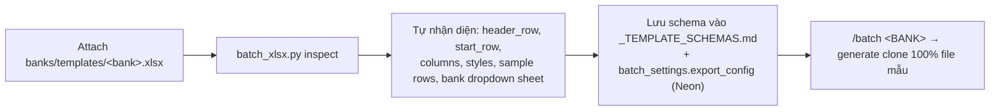

# 📐 Universal Batch Excel Template Registry (`_TEMPLATE_SCHEMAS.md`)

> 🚧 **SKELETON** — chưa attach file `.xlsx` nào. User sẽ gửi file mẫu từng ngân hàng sau.
> Khi có file: chạy `inspect` → điền schema YAML bên dưới → `/batch <BANK>` hoạt động zero-code.

## 1. Zero-Code Onboarding Flow (thiết kế đã chốt)



**Nguyên tắc `generate`:** clone nguyên bản 100% `.xlsx` mẫu (Font, Border, Cell Style `s="..."`, Merged Cells, Data Validation Dropdown, `customXml`, sheet danh mục ngân hàng) — chỉ thay data rows trong `sheet1.xml` + cập nhật `sharedStrings.xml`.

**Công cụ (TODO — chưa tạo):** `scripts/batch_xlsx.py inspect|generate` (zero-dependency, giải nén XML gốc).

## 2. Schema Mapping (TODO — điền sau khi inspect)

Mỗi ngân hàng một block YAML. Cấu trúc dự kiến:

```yaml
# bank_type: <BANK>
# template_file: batches/templates/<bank>.xlsx
# target_sheet_xml: xl/worksheets/sheet1.xml
# sheet_name: <tên sheet>
# header_row: <n>
# start_row: <n>
# clear_existing_data_rows: true|false
# bank_lookup_field: <field>
# bank_lookup_sheet: xl/worksheets/sheet2.xml
# bank_lookup_col: <A|C|...>
# columns:
#   <A..F>: { field: index|bank_number|receiver_name|mapped_bank_name|amount|note, type: number|string, style_id: "<s>", header: "<text>" }
```

### 2.1 MBB — `mbb.xlsx` (TODO: attach + inspect)
- Sheet dự kiến: `eMB_BulkPayment` · header_row 2 · start_row 3.
- Cột dự kiến: A index / B bank_number / C receiver_name / D mapped_bank_name / E amount / F note.
- **Status:** ⏳ chờ file mẫu.

### 2.2 VIB — `vib.xlsx` (TODO: attach + inspect)
- Sheet dự kiến: `Chuyển tiền nhanh 247` · header_row 4 · start_row 5 (xóa sample rows).
- Cột dự kiến: A index / B receiver_name / C bank_number / D amount / E note / F mapped_bank_name.
- **Status:** ⏳ chờ file mẫu.

### 2.3 Ngân hàng khác (TCB, VCB, ...) — TODO
- Quy trình: bỏ file vào `batches/templates/` → `inspect` → thêm block YAML → `/batch <BANK>`.

## 3. Liên kết
- Skill: `skills/batch-transfer/SKILL.md`
- DB: `batch_settings.export_config`, `bank_mappings` (TODO port)
- Bất biến: `skills/invariants.md` §5