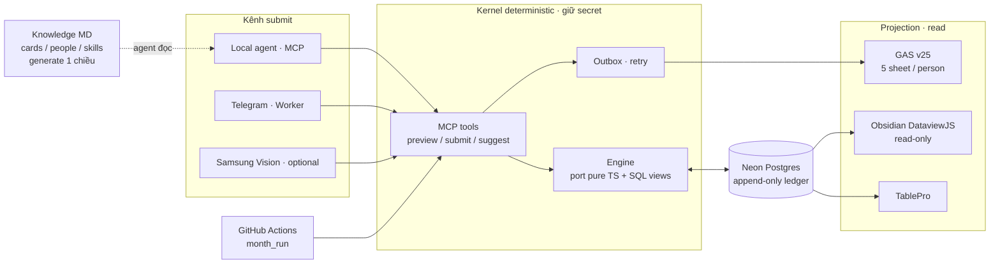
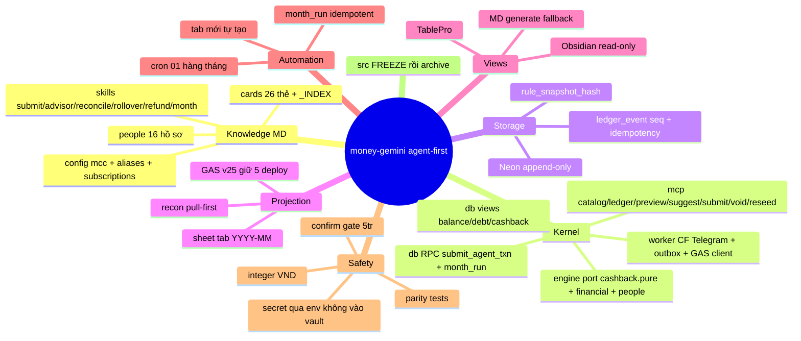
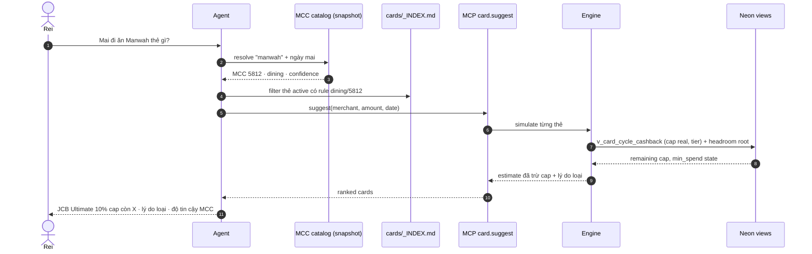

# Agent-First Blueprint — money-gemini

> [!summary] TL;DR
> | Câu hỏi | Chốt |
> |---|---|
> | "Zero-code" literal? | **Không khả thi** (20 thẻ tier/cap + rollover). Làm **zero *app* code** |
> | Giữ lại gì? | Kernel nhỏ: port **pure TS đã test** + SQL views + worker ~150 dòng + **GAS v25 nguyên** |
> | Nguồn sự thật? | **Neon append-only**; balance/debt/cap = **view tính lại**; LLM **không tính tiền** |
> | Markdown? | Knowledge (rule/people/skills) **generate 1 chiều từ DB** |
> | Google Sheets? | **Projection** qua **outbox retry** (bỏ trigger fire-and-forget) |
> | Thực thi ở đâu? | **money-gemini only**; repo nháp `finance-manage-ag` + 2 doc top-level = **read-only** |

---

## 1. Overview — nhìn 1 phát hiểu

### 1.1 Kiến trúc mới (data flow)



### 1.2 Cấu trúc repo đích (mindmap)



---

## 2. Cũ vs Mới

| Tiêu chí | Cũ (app-centric) | Mới (agent-first) |
|---|---|---|
| Entry | Next.js API / Quick Add / Hermes / bot in-app | Agent任意 qua MCP; Telegram qua Worker |
| Nguồn sự thật | Supabase + trigger | Neon append-only (cùng schema, bỏ trigger) |
| Balance/debt | service đọc-on-demand (đã đúng) | SQL views (parity 0 VND ở M2 nháp) |
| Cashback | fire-and-forget **3× recompute** sau insert | engine đồng bộ, port `cashback.pure.ts`, khóa rule snapshot |
| Sheet sync | trigger→pg_net→Edge→GAS, **no retry, race** | outbox→worker→GAS, **retry + idempotent**, 1 reseed/batch |
| Audit | events cho vài state change | mọi mutation = event có seq + idempotency_key |
| Rules | DB 58 rows | DB bản chạy + MD generate 1 chiều |
| Code phải giữ | hàng chục nghìn dòng app | ~1.000 pure (đã có) + views + ~150 worker + GAS |

**Dependencies mới & fallback**

| Dependency | Rủi ro | Fallback |
|---|---|---|
| LLM (Mistral/local) | hallucination, overflow | schema validate + confirm; **cấm LLM tính tiền** |
| MCP kernel / Worker | down, cold start | CLI đọc DB thẳng; retry; pooler Neon |
| Neon | free pause, ~300ms cold | pg_dump nightly; Supabase read-only 2 tuần đầu |
| GAS / Sheets | quota, OAuth, "Server busy" | outbox retry; CSV; reseed tay; giữ 5 deploy ID |
| Obsidian Dataview | plugin đổi API, iPad sandbox | MD report generate từ views; TablePro |
| GitHub Actions | missed/duplicate run | idempotency `(job,period,entity)`; `workflow_dispatch` |
| MCC dataset 55k | API cá nhân chết, license | **snapshot local** + alias; không redistribute |

---

## 3. Hiện trạng & bất biến phải giữ (đã verify code)

### 3.1 Vì sao luồng cũ dễ lệch

| Lỗ hổng | Bằng chứng |
|---|---|
| API trả 200 **trước khi** cashback + sheet xong | route.ts:218–225 fire-and-forget |
| **3× recompute cả kỳ** thừa, lỗi chìm | `updateCashbackCycle`×2 + `calculateTransactionCashback`×1 → cùng `recalculateCycleCashback` (cashback.service.ts:71) |
| Không UPDATE trigger; không retry | grep migrations chỉ INSERT + DELETE; pg_net fire-and-forget |
| Race 4 insert → 2 dòng sheet | ghi nhận 2026-11-11; GAS lock 30s |
| Hardcode hỏng | `pushManualToDB` URL giả (Code.js:249); `auto-pay` UUID VCB Digi (auto-pay/index.ts:76) |

### 3.2 Công thức tài chính (bất biến)

**Balance** (`financial.ts:75`, `financial.service.ts:48`) — chỉ `posted`, loại `not_calculate_balance`, family gom `parent_id ?? id`:

| Loại | Công thức |
|---|---|
| Bank/wallet/cash | `initial + Σincome − Σexpense` |
| Credit card đơn | `credit_limit − Σexpense + Σincome` |
| Family có parent là card | `parent.credit_limit − Σexpense + Σincome` **cả family** |

**Debt** (`financial.ts:97,164`, `financial.service.ts:183`): `net = total_lent − total_repaid`; lent = expense (không repayment) theo `final_price`; repaid = repayment + income. Effective cycle = `debt_cycle_tag || persisted_cycle_tag || tháng`. Bảng `debts` **chết** (không query trong `src/`).

**Cashback** (`cashback.pure.ts`, 361 dòng, 2 engine):

| Engine | Luật chốt |
|---|---|
| Standard | match category exact → merchant_match → base. `max_budget` = **MAX các budget / account / kỳ** (null=unlimited, 0=chặn). Cap trừ **lũy kế occurred_at ASC**. `sub_caps` lồng, `min_cycle_spend`, `exclude_mcc` |
| Tiered | `tier_thresholds` chọn theo tổng chi kỳ; `rate_table` low/high (tier cao nhất dùng high); `base_rate`, `min_spend`, `min_txn_amount` |
| Loại trừ | note `create initial/rollover/hoàn tiền/cashback`; category `transfer/system/internal`; `is_excluded` |

**Cycle tag** (`dateRange.ts:143`): `day < billing_day` → tháng này; `>=` → tháng kế. `persisted_cycle_tag` (sao kê thẻ) ≠ `debt_cycle_tag` (công nợ/sheet) — **không trộn**.

### 3.3 Edge-case dễ mất khi port

| Nghiệp vụ | Bất biến | Bằng chứng |
|---|---|---|
| Rollover | Cặp `[Debt Rollover]` trên `SERVICE_PENDING`=`77777777-8888-8888-8888-777777777777`; expense nhưng **không lending**; chỉ đổi `debt_cycle_tag`. Cascade match `person+amount+notes LIKE` **không FK** → phải thay **correlation ID** | people/actions.ts:294; knowledge/17:175 |
| FX fee | `fx_fee_rate`→txn `foreign_fee` `ROUND(purchase×rate)` `status=deferred` (loại khỏi balance/cashback/sheet); JCB `fx_fee_on_refund=true`; Post Statement→posted | knowledge/19:16,38,51; financial.service.ts:91 |
| Refund | `posted/completed/cancelled→waiting_refund`; +chưa GD3→confirm(GD3 income)→`refunded`; rollback→`posted`; partial `0<amt≤|original|`. Sheet lỗi **không rollback DB** | refundGuards.ts:17,25,40,58,90 |
| Real vs virtual | `real_awarded` (thực nhận) tách `virtual_profit`; cap còn lại theo **real** (Q3); ΣBack sheet theo **amount txn** | financial.service.ts:389,419 |
| Installment | `occurred_at=cycle_tag+"-01"`, `not_calculate_balance=true`. **Drift subtype**: generateTxnForSlot không set, plan path + sync-subscriptions =`repayment` | installment.service.ts:264,281,190,209 |
| Subscription | `subtype=lent`, `raw_input=[subscription:id]`, prepaid skip; `perSlot=ROUND(price_per_cycle/total_slots)`; slot thừa gộp 1 người | sync-subscriptions:409,448–450 |

### 3.4 Hợp đồng sheet GAS v25 (giữ từng ô)

| Cột | Nội dung | | Cột | Nội dung |
|---|---|---|---|---|
| A | ID (hidden, khóa upsert) | | H | đ Back |
| B | In/Out | | I | Σ Back `ARRAYFORMULA (F*G/100)+H` |
| C | Date dd-MM | | J | Final Price `ARRAYFORMULA` |
| D | Shop `ARRAYFORMULA VLOOKUP+IMAGE` | | K | Recon (user sửa, pull-first) |
| E | Notes | | M–O | Summary O2:O5; M6 bank; M7:O18 QR |
| F | Amount | | P,Q | Src, SortKey (hidden) |
| G | % Back | | Tab | `YYYY-MM`/`YYYY`, **tự insertSheet** (Code.js:585–590) |

Mỗi person 1 spreadsheet + 1 deploy (`deploy_configs.type=people_sync`, 5 rows). Recon **pull-first**; FULL_SYNC phải select recon kẻo wipe K.

### 3.5 Doc-drift — PHẢI reconcile trước khi generate MD

> [!danger] Nguồn sự thật = **cột DB + `cashback.pure.ts`**, KHÔNG phải doc/SKILL/tools.ts.
> | Nguồn sai | Nó ghi | Thực tế | Bằng chứng |
> |---|---|---|---|
> | add-cashback-rules SKILL + **ai/tools.ts:257** | `rate_percent, category_ids[], mcc_codes[], max_cashback, priority` | `rate, max_budget(MAX), sub_caps, min_cycle_spend, merchant_match, exclude_mcc` | cashback.pure.ts |
> | README.md:139 | `cashback_rate, category_id, min_spend` | tên cột khác nữa | — |
> | knowledge/07 | volunteerProfits khác | `cb−sumBack`; remaining=`maxBudget−cumulativeCB` | cashback-budget.ts:194,196 |
> | knowledge/22:12,32 | `price_per_cycle`=per slot | =**tổng giá**; `ROUND(/total_slots)` | sync-subscriptions:83,409 |
> | people/[id]/page.tsx:381–409 | `max_cashback_cap, cashback_percent…` (as any) | cột không tồn tại → path chết | — |

### 3.6 Tài sản reuse & kiểm kê data

| Module | Dòng | Vai trò mới |
|---|---|---|
| `cashback.pure.ts` | 361 | **Port nguyên** làm cashback engine |
| `financial.ts` / `people.ts` | 186 / 218 | Balance + debt + summary |
| `agent-submit.ts` | 243 | Validate + normalize payload |
| `dateRange.ts` (computeCycleTag) | ~30 | Cycle tag |
| `Code.js` GAS v25 | 1.165 | **Giữ nguyên deploy**, đổi caller |

Data (~4.000 rows, dump <20MB): `transactions` **996**, `transaction_events` **1.224 (audit, không mất)**, `cashback_rules` **58/20 thẻ**, `accounts` **59/26 active**, `people` 16, `installment_plans/slots` 9/81, `subscriptions` 18, `deploy_configs` **5**, `bank_mappings` 47, `categories` 38, `shops` 23.

> [!important] Insight
> Hệ hiện tại **đã là** append-only + derived + recompute cả kỳ. Sai ở **chỗ đặt** (fire-and-forget, 3× thừa, no retry) + **coupling**, không phải paradigm → migration = **di dời kernel đã test**, không thiết kế lại.

---

## 4. Kiến trúc mới — luật & lựa chọn

### 4.1 Phân vai tuyệt đối

| Thành phần | ĐƯỢC | KHÔNG |
|---|---|---|
| Agent/LLM | parse, resolve tên, đọc rule, đề xuất, xin confirm | cộng/trừ tiền, ghi balance/debt/cap, tự tạo entity mơ hồ |
| MCP kernel | validate, idempotency, append event, gọi engine, outbox | sửa lịch sử, tin snapshot agent đưa |
| Engine (views + TS) | tính balance/debt/cashback từ ledger + rule version | phán đoán ngữ nghĩa |
| Markdown | rule/workflow/catalog | làm ledger mutable |
| Sheets / Obsidian | projection + recon input | nguồn sự thật balance |

**8 luật cứng:** ① integer VND ② mọi mutation = event `seq`+`idempotency_key UNIQUE`+`rule_snapshot_hash` ③ balance/debt/cap = view ④ cashback khóa tại submit (Q7) ⑤ cap theo **real** (Q3) ⑥ family headroom theo **root** (Q5) ⑦ sheet qua **outbox retry**, hỏng ≠ mất txn ⑧ recon **pull-first**, 2 cycle tag không trộn.

### 4.2 Engine đặt ở đâu

| Bài toán | Công cụ | Vì sao |
|---|---|---|
| Balance/family/debt/cycle spent | **SQL views** Neon | parity 0 VND (M2 nháp); mọi client đọc cùng kết quả |
| Cashback tier/cap/sub-cap | **Port `cashback.pure.ts`** trong kernel | 361 dòng đã test; viết lại plpgsql = rủi ro parity không cần |
| Cycle/normalize/validate | Port `dateRange.ts`+`agent-submit.ts` | pure, đã test |
| Submit atomic | RPC `submit_agent_txn` | 1 transaction: event + ledger + cashback_amount |

**Parity gate:** chạy engine mới trên 996 txn → so `cashback_cycles`/`cashback_entries` từng kỳ từng thẻ + balance 59 account. **Lệch ≠ 0 = chưa cutover.**

### 4.3 Storage matrix

| Phương án | Submit mọi nơi | Chống lệch | iPad | Kết luận |
|---|---|---|---|---|
| Sheets làm DB | Tốt | TB (race/quota) | Tốt | Loại: không atomic |
| MD + Dataview làm DB | Kém | Kém | TB | Loại: chỉ knowledge/view |
| SQLite local + git | TB | Tốt | **Kém** (iPad không sqlite3) | Chỉ khi 1 máy Mac |
| **Neon + views + MCP** | **Tốt** | **Tốt nhất** | **Tốt** (HTTP SQL fetch) | **Khuyến nghị** |

Vì sao Neon: iPad sandbox không chạy sqlite3 → `fetch()` HTTP SQL chạy mọi nơi; multi-writer; 126 migrations Postgres thuần `pg_dump` giữ UUID; M2 nháp đã parity 0.

### 4.4 Kênh submit & view

| Kênh | Đường đi | Ghi chú |
|---|---|---|
| Local agent | MCP stdio → kernel → Neon | Antigravity/Claude/OpenCode đọc chung skills |
| Telegram | Worker (port `commands.ts`) → Mistral → kernel | 24/7 không cần Mac; confirm >5tr inline button |
| Samsung | Share ảnh → Worker → Pixtral OCR → confirm | optional, phase sau |
| Xem | Obsidian DataviewJS **read-only role** / TablePro | **không nhét conn string ghi vào vault** (sửa lỗi bản nháp) |

### 4.5 Rule thẻ bằng MD (token budget)

Agent đọc `cards/_INDEX.md` (~26 dòng frontmatter) trước → chỉ mở body thẻ match. **Không nạp 20 thẻ cùng lúc.** MD có header `<!-- generated -->`; CI generate 2 lần `git diff --exit-code` + **gate schema khớp `cashback.pure.ts`**. Format (minh hoạ, giá trị generate từ DB):

```yaml
card_id: shinhan-supreme
family_root: shinhan-cashback-365   # chung hạn mức 103.2tr
billing_day: 26
cashback_type: tiered
tier_thresholds: [{spend: 3tr, cap: 300k}, {spend: 15tr, cap: 1tr}]
rate_table: [{category: online, rate: 0.12}, {category: health, rate: 0.06}]
rule_version: 3
# Thẻ cha Shinhan Cashback 365 = engine standard: 12% Supermarket/Food, min_spend 3tr, cap 400k
```

### 4.6 Zero-touch hàng tháng (`month_run` idempotent)

| Bước | Việc |
|---|---|
| 1 | Lock `(job,entity,YYYY-MM)`; key trùng → skip |
| 2 | Subscriptions: `next_due<=today` → txn + advance + prepaid skip |
| 3 | Installments: slot pending → `generateTxnForSlot`, `not_calculate_balance=true` |
| 4 | Auto-pay: salary→card; **bỏ hardcode UUID** (đọc config) |
| 5 | Recompute projection → outbox reseed **từng person** → GAS **tự tạo tab** |
| 6 | Ghi `runs/YYYY-MM.md`; retry an toàn |

Cron `5 0 1 * *` (đã có). **Cửa sổ cấm migrate 28→3**; dry-run `2027-01` trước 30/12; **01/01 = test thật** (tab mới tự sinh cả 5 sheet).

---

## 5. Sơ đồ luồng

### 5.1 Submit "Cọc FPT 30tr cho Tuấn · Shinhan Supreme · hôm qua"

```mermaid
sequenceDiagram
  autonumber
  actor U as Rei
  participant A as Agent
  participant M as MCP Kernel
  participant E as Engine
  participant DB as Neon Ledger
  participant O as Outbox
  participant G as GAS v25 (sheet Tuấn)

  U->>A: "Cọc fpt 30tr shinhan supreme cho Tuấn hôm qua"
  A->>M: catalog.resolve + txn.preview
  M->>E: cycle tag (billing_day) + family root + simulate cashback
  E->>DB: đọc rules + cap real kỳ
  DB-->>E: spent, cap_used, headroom root
  E-->>M: preview (30tr, expense, Tuấn, debt 2026-11)
  M-->>A: needs_confirm (>5tr)
  A->>U: Confirm 30tr · Tuấn · Shinhan Supreme (family 365)?
  U-->>A: Confirm
  A->>M: txn.submit(idempotency_key, payload, rule_snapshot_hash)
  M->>DB: BEGIN; unique key; append event; khóa cashback; COMMIT
  DB-->>M: event_seq
  M->>E: recompute balance family + debt + cap (đồng bộ)
  E-->>M: numbers + source_seq
  M->>O: enqueue sheet job
  O->>G: upsert/reseed tab 2026-11 (retry)
  M-->>A: receipt + số + sync status
  A-->>U: Đã ghi #seq · Tuấn nợ X · headroom Y · sheet synced
```

### 5.2 Advisor "Mai đi ăn Manwah thẻ gì?"



---

## 6. Migration (thực thi trong money-gemini)

> App cũ chạy đến khi parity đạt; mỗi phase có gate, không đạt = dừng; rollback từng phase. Sprint `M4-Sx-…` (1 sprint = 1 PR).

| Phase | Việc | Gate (không đạt = dừng) | Rollback |
|---|---|---|---|
| **M0** Freeze+backup | pg_dump; tag `pre-v2`; golden snapshot 5 sheet; export 5 deploy; đếm 996+**1.224** | restore thử được; snapshot khớp 100% | không ảnh hưởng |
| **M1** Knowledge export | DB→`cards/people/_INDEX`; skills/invariants; CI generate 2 lần | diff rỗng + **schema MD khớp engine** | xóa thư mục |
| **M2** Ledger Neon | reuse M2 nháp nếu hợp lệ; pg_dump giữ UUID; views + RPC | **parity 59=0 VND**; debt + cashback khớp | trỏ lại Supabase |
| **M3** Kernel read-only | port pure TS; MCP catalog/ledger/preview/suggest; MCC snapshot | 10 câu eval đúng; Manwah→5812→JCB top1; golden parity | tắt MCP |
| **M4** Write+sheet | submit/void/refund/rollover + idempotency + confirm; outbox GAS; **bỏ trigger trước reseed** | submit trùng=1 row; reseed khớp từng ô (trừ K); 1 reseed/batch | tắt writer, dùng app |
| **M5** Channels+Views | Worker Telegram + Mistral; Obsidian 4 dashboard **read-only**; Samsung optional | bot 24/7; iPad đúng số; vault no credential ghi | tắt worker |
| **M6** Automation+shadow | `month_run` + retarget cron; dry-run 2027-01; shadow 10 ngày | **01/01 tab mới tự sinh 5 sheet**; 0 lệch 10 ngày | cron về edge cũ |
| **M7** Decommission | tắt Hermes/Quick Add; archive `src`→`.archive` `@archived`; Supabase read-only 2 tuần | app không gọi 2 tuần; restore drill ok | checkout `pre-v2` |

**Checklist bảo toàn trước cutover**

- [ ] 996 txn + **1.224 events** đếm khớp sau restore
- [ ] 58 rules + type_configs không mất tier/cap/min_spend/MCC/sub-cap; **MD schema khớp engine**
- [ ] 5 deploy giữ **nguyên spreadsheet ID + deploy_id**
- [ ] Rollover `SERVICE_PENDING` giữ cặp; **correlation ID thay heuristic**; `isLending=false`
- [ ] FX `deferred` (kể cả JCB refund) không lẫn balance; refund GD3 link đúng; installment `not_calculate_balance`
- [ ] `real_awarded` tách virtual; subscription `perSlot=ROUND(total/slots)`
- [ ] Sheet A:K + P/Q, O2:O5, M6, M7, ARRAYFORMULA D/I/J — reseed khớp từng ô
- [ ] 2 cycle tag tách; `final_price`; split_group_key không double-count

Timeline ~8–10 tuần, 6–8h/tuần. Trượt → cắt M5 Samsung + M7, dừng M6 vẫn đạt mục tiêu chính.

---

## 7. Rủi ro & câu hỏi chốt

| Rủi ro | XS | AH | Chặn bằng |
|---|---|---|---|
| **MD sinh từ doc drift** | Cao | Cao | generate từ DB + engine; gate schema (§3.5) |
| Sheet lệch sau migrate | TB | Cao | golden snapshot mỗi merge |
| Cashback port lệch semantics | TB | Cao | golden parity từng kỳ |
| LLM tính tiền sai | TB | Cao | tool trả số; cấm arithmetic |
| Rollover nhầm cặp (không FK) | TB | Cao | correlation ID; test 2 khoản cùng tiền |
| Mất audit events | Thấp | Cao | đếm 1.224 sau restore |
| Double-sync còn trigger | TB | TB | bỏ trigger **trước** reseed |
| Credential trong vault | TB | Cao | read-only role / Worker proxy |
| MCC API chết | Cao | Thấp | snapshot + alias |
| Neon cold start/pause | Chắc chắn | Thấp | pooler + retry; backup nightly |

**Câu hỏi cần Rei chốt**

| # | Câu hỏi | Mặc định |
|---|---|---|
| 1 | Neon free + backup nightly vs Supabase Pro 1 tháng? | Neon (reuse M2 nháp) |
| 2 | LLM Worker: Mistral Small/Pixtral vs provider hiện tại? | Mistral |
| 3 | Reuse tài sản nháp `finance-manage-ag` (đã parity) vs làm lại? | reuse có kiểm chứng, không touch repo đó |
| 4 | Giữ GAS v25 vs Sheets API trực tiếp? | giữ GAS v25 |
| 5 | Ngưỡng confirm 5tr (Q2)? | giữ |
| 6 | Samsung Vision ở M5 hay sau? | sau |

---

## 8. Acceptance — định nghĩa "xong"

- [ ] Rebuild từ ledger ra đúng available thẻ đơn + family (root)
- [ ] Debt đúng `debt_cycle_tag`; repayment khác kỳ sao kê vẫn đúng
- [ ] Cashback đúng tier/cap/sub-cap/min_spend/MCC + rule version; **parity 0**
- [ ] `cards/*.md` schema khớp `cashback.pure.ts` (không từ doc drift)
- [ ] Cap còn lại theo `real_awarded`; FX `deferred` loại khỏi balance
- [ ] Retry cùng idempotency_key = 1 row; cancel/refund/rollover có correlation ID
- [ ] Split chỉ tính children; installment không double-count
- [ ] `month_run` chạy lại không duplicate; tab mới tự sinh cả 5 sheet
- [ ] Sheet outage không mất txn; recon pull-first không wipe K
- [ ] Obsidian iPad đúng số; vault không credential ghi; backup restore máy sạch
- [ ] Không workflow nào để agent ghi snapshot balance